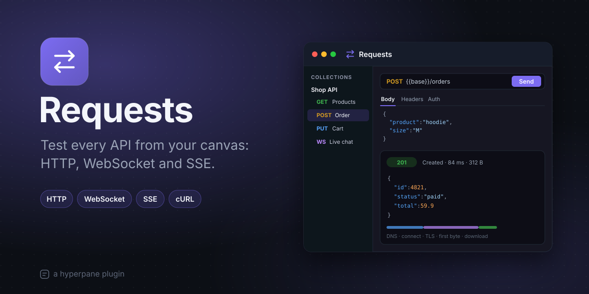

# Requests

Test every API from your canvas: HTTP, WebSocket and SSE. Requests is a
Postman alternative in a window, laid out as Postman is: a sidebar with
the environment, your collections and the history, a strip of open tabs,
and the open request with its answer below or beside it. Collections live
in the project, so your team gets them with the code.

## Features

- **Any HTTP method** (GET, POST, PUT, PATCH, DELETE, HEAD, OPTIONS, or one
  of your own), with `{{variables}}` colored in the URL (red when they
  aren't set).
- **Params**, kept in step with the URL's query; **headers** sent as typed
  (their case, repeated ones too), with the common names suggested.
- **Every kind of body:** JSON (with Beautify), text, XML, HTML or
  JavaScript, a URL-encoded form, a multipart form (text fields and files),
  a file as it is, or **GraphQL** (a query and its variables).
- **Auth:** a bearer token, Basic, an API key (in a header or the query),
  or inherited from the folder or the collection.
- **Per-request settings:** the timeout, following redirects (up to 10),
  ignoring TLS errors.
- **A full answer:** the status, time and size; the body pretty (a JSON
  tree you can search), raw, or previewed (images, HTML); copied or saved
  to a file; the headers in order; the cookies it set; **timings** as a
  waterfall (lookup, connect, TLS, first byte, download) with the
  redirects, the address and the certificate; and the request as a
  **cURL** command.
- **WebSocket:** headers, subprotocols, ignoring TLS errors, and
  reconnecting when it drops. Read the messages as a **chat** (what you
  send on the right, what comes on the left; JSON as a tree, binary as
  hex) or as a **log** (a line a message, with direction, time and size;
  filter, copy, clear). Send text, JSON, or bytes as hex or base64; keep a
  message as a template and click it to send it again; ping; disconnect
  with the closing handshake.
- **Server-Sent Events:** a request whose answer is `text/event-stream`
  shows its events as they're sent (the name, the id, the data).
- **Collections** with folders, their own variables and auth, kept in the
  project.
- **Environments:** sets of variables chosen in the sidebar. Secret
  variables (the lock) keep their values on this machine only.
- **History:** the last 300 requests you sent. Click one to open it again.
- **Import and export:** paste a **cURL** command (as a browser's “Copy as
  cURL” gives it) to open it as a request, or import a **Postman**
  collection (v2.1) or environment. Any request copies as cURL; a
  collection exports as a Postman v2.1 file.

## How to use

1. Open it: right-click the canvas and choose **New Requests**.
2. Make a collection in the sidebar, or paste a cURL command or import a
   Postman collection.
3. Type a URL, pick the method, and **Send** (⌘↵, Ctrl+Enter on Windows
   and Linux). **Save** it to a collection with ⌘S (Ctrl+S).
4. For a WebSocket, choose **New WebSocket**, connect, and type in the
   composer: Enter sends, Shift+Enter starts a new line.

## Good to know

- Every request goes from the server, not from the window: no CORS, the
  server's own `localhost` in reach, and certificates checked or not, as
  each request says.
- gzip, deflate and Brotli answers are decompressed; bodies over 50 MB are
  cut.
- Collections are kept in `.hyperpane/requests/collections.json`: commit
  them and your team has them. Environments are kept in the project too,
  except secret values, which stay on this machine. History stays on this
  machine.

## How it works

The window is the client part; requests are sent by its server part, a
Node process next to the project, which also keeps the collections,
environments and history. WebSocket and event-stream connections live
there too, and their messages stream to the window.

| Where | What it is |
| --- | --- |
| `src/server/` | The server part: HTTP (`http/`), WebSocket (`ws/`), event streams (`sse.ts`), the store (`store.ts`). |
| `src/shared/` | Requests, answers, collections and variables, and the cURL and Postman formats. |
| `src/client/` | The window: the sidebar, tabs, the request's panels, the answer, and the WebSocket views. |
| `test/` | The tests. |

## Develop

    ./build.sh --test

## License

MIT, © 2026 Astralyx. See [LICENSE](LICENSE).
